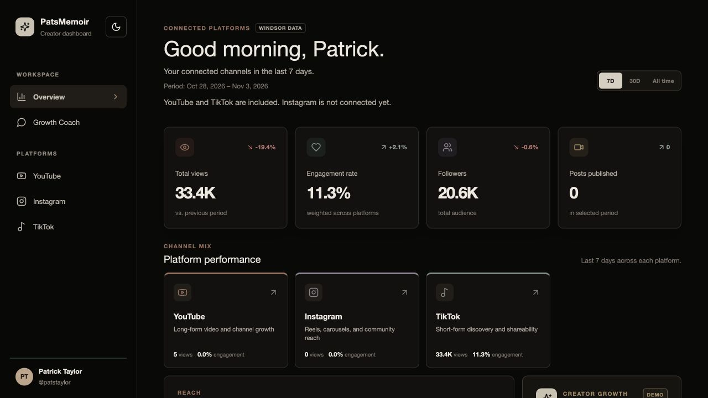
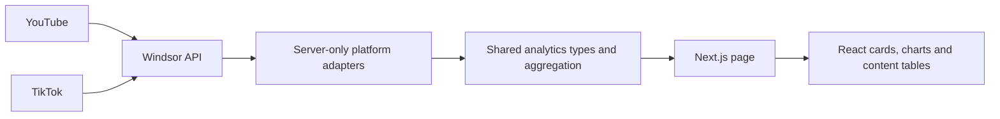

# PatsMemoir Creator Analytics

A deployed creator dashboard that brings my YouTube and TikTok analytics into one workspace. Built from a real problem in my content workflow: understanding reach, audience growth, and engagement without switching between platforms.

**[Open the live dashboard](https://creator-dashboard-roan.vercel.app/)** · **[My portfolio](https://builtbypat05.github.io/builder.html#creator-dashboard)**



*Screenshot captured November 2026. Values change as the connected sources update.*

## Current status

The dashboard is deployed on Vercel and retrieves real account data through Windsor.ai. It is a working personal project with ongoing development, not a finished multi-user analytics service.

| Area | Status |
| --- | --- |
| YouTube | Connected through Windsor: daily analytics, channel totals, and published videos |
| TikTok | Connected through Windsor: available daily analytics, account totals, and video catalogue |
| Overview | Combines available YouTube and TikTok data and shows each platform's content |
| Instagram | Interface present; connection pending. Displays an empty state and zero values |
| Growth Coach | Scripted, deterministic demo; no AI model or stored conversations |
| Facebook / Supabase | Removed from the current implementation |

## Features

- Shared 7-day and 30-day reporting controls, plus a separate all-time summary.
- Separate views, followers, and engagement charts with hover exploration, keyboard controls, and chart visibility toggles.
- Platform pages and a combined overview, with a view-weighted engagement calculation.
- Published-content tables ranked by lifetime views, ten posts at a time, with links to original posts.
- Responsive navigation, independent content scrolling, and light/dark themes.
- Server-side API access, request timeouts, and independent handling of platform failures.

## My role and development process

I defined the requirements from my experience running PatsMemoir, directed implementation, reviewed and tested the results, configured the data connections, and deployed the application. I used Claude Code initially and then Codex to assist development while owning the product decisions and validation.

1. **Prototype:** built navigation, metrics, charts, and content tables using local sample data.
2. **Refine the experience:** separated metrics with different units into individual charts; improved mobile navigation, themes, and scrolling.
3. **Integrate real data:** moved from an exploratory Supabase/direct-connector approach to Windsor for the immediate project scope.
4. **Clarify reporting:** distinguished period analytics, account totals, and lifetime video views instead of presenting them as interchangeable.
5. **Deploy:** published on Vercel with server-side configuration and linked content back to the source platforms.

The main lesson was to validate what a metric means before deciding how to visualize or combine it. A shared interface does not mean every platform supplies identical history or fields.

## Technology stack

| Technology | Purpose |
| --- | --- |
| TypeScript | Shared data types and application logic |
| Next.js 16 / React 19 | Server-rendered routes and interactive dashboard components |
| Tailwind CSS 4 / CSS | Responsive styling and theme rules |
| SVG / Lucide React | Custom chart rendering and interface icons |
| Windsor.ai REST API | Connector for YouTube and TikTok source analytics |
| Vercel | Hosting, server execution, and environment configuration |

No database or authentication service is required by the current application.

## Architecture



The adapters request fields from Windsor, validate the response envelope, convert values, and map rows into the dashboard's shared types. `getLiveDashboard()` loads the platform datasets independently, builds the available overview, and passes serializable data to the React interface. API credentials remain on the server.

```text
src/app/                         Overview, platform and Growth Coach routes
src/components/dashboard/       Navigation, metrics, charts, tables and coach UI
src/lib/integrations/windsor/    YouTube and TikTok requests and data mapping
src/lib/analytics/              Overview aggregation and all-time summaries
src/lib/dashboard-data.ts       Shared types, platform metadata and formatting
```

## Data definitions and limitations

- **Freshness:** Windsor requests use a one-hour Next.js cache (`revalidate: 3600`). Refreshing the browser does not guarantee newer source data. Windsor and the platforms have their own reporting delays; this is not a real-time feed.
- **Period metrics:** shared controls expose 7 and 30 days. The YouTube adapter also supports longer history, while TikTok daily requests currently use the available 60-day window. Historical availability depends on the connector and account.
- **Followers:** audience totals are snapshots, not the number gained in the selected period. YouTube history is reconstructed from current subscribers and reported gains/losses; TikTok uses reported follower counts and carries forward available values.
- **Engagement:** daily rates use likes, comments and shares divided by views. The overview weights rates by views. Post-level YouTube engagement uses likes and comments because those are the fields requested for the catalogue.
- **All time:** account totals are separate from historical charts. TikTok account lifetime views are unavailable; the sum of returned video views is labelled as tracked-video views, not a verified account total.
- **Content:** lists use Windsor's returned catalogue, independent of the period selector. Retrieval begins at January 1, 2018 and may not include every historic, deleted, private, or unavailable post.
- **Failures and missing data:** a failed platform request does not reject the entire dashboard. The current UI can show zeros or unavailable values. Missing daily fields can also become zeros; those values should not be treated as proof of no activity. Better completeness indicators are future work.
- **Audience:** follower totals across platforms are not deduplicated people. This public dashboard has no user accounts or persistent database.

## Run locally

Use Node.js 22 or newer:

```bash
git clone https://github.com/builtbyPat05/patsmemoir-creator-analytics.git
cd patsmemoir-creator-analytics
npm ci
cp .env.example .env.local
```

Set your own `WINDSOR_API_KEY` in `.env.local` and connect the appropriate YouTube and TikTok accounts in Windsor. Then:

```bash
npm run dev
```

Open [localhost:3000](http://localhost:3000). Without a key, the interface renders with empty data. Never commit `.env.local`, put the key in browser code, or use a `NEXT_PUBLIC_` prefix for it.

If the project lives in an iCloud-managed folder, keep it downloaded so dependency files remain available.

## Verify and deploy

```bash
npm run check
npm run build
npm start
```

`check` runs ESLint and TypeScript. These checks and a production build passed for this repository update; the project does not yet have a comprehensive automated test suite.

Deploy the Next.js project on Vercel and set `WINDSOR_API_KEY` in the appropriate deployment environment. The current live app was deployed from the local project using `npx vercel --prod`. GitHub pushes only trigger Vercel deployments after a Git integration is configured. Environment variables persist between deployments; changing one requires a new deployment.

## Next steps

- Complete the Instagram connection and validate its reporting fields.
- Distinguish missing data from measured zero activity more consistently.
- Add adapter fixtures and tests for aggregation, incomplete responses, and reporting periods.
- Improve data freshness and source-coverage indicators.
- Evaluate a real Growth Coach integration after the analytics foundation is validated.
